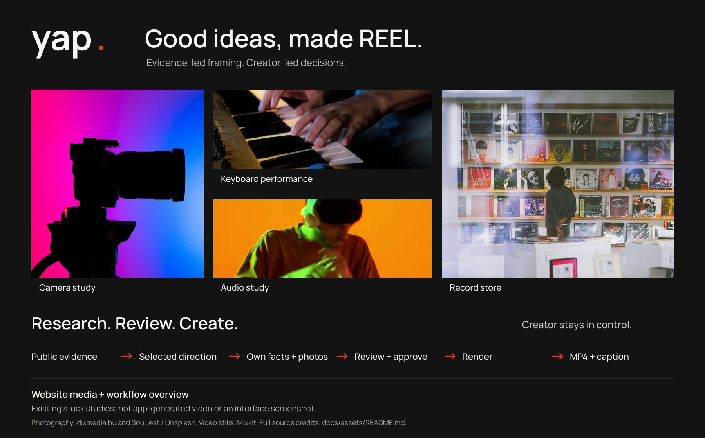
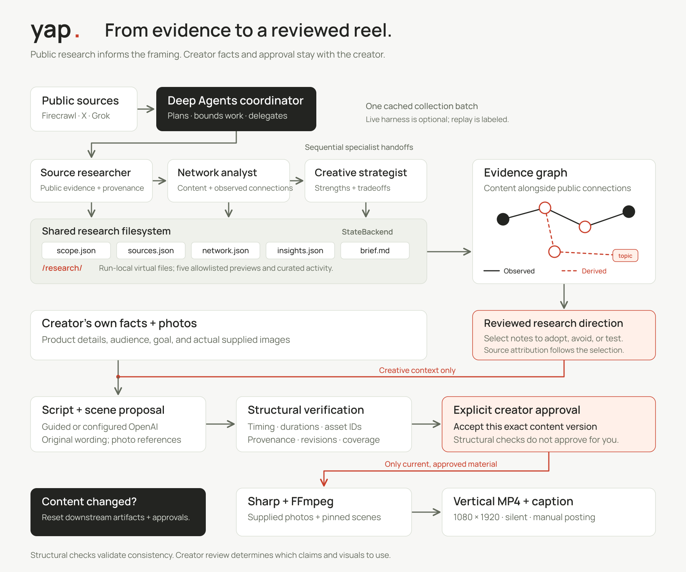
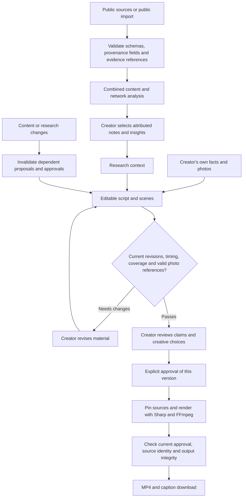

# yap.

**Good ideas, made REEL.**

Yap is a research and short-video workspace for creators. Start with an idea, product, place, public GitHub project, or your own photos. Explore public examples, choose a creative direction, and develop an original film you can review and download. Entertainment and media creation guide the product; the small-business photo promo remains a working use case.

**Guided** asks useful questions while research runs; **Director** exposes the same saved script, sources, shot plan, and clip review. The landing phone opens this connected studio. See the [creator studio plan](docs/creator-studio-plan.md) for the product journey and [creator backend guide](docs/creator-backend.md) for sessions, approved generation limits, and clip audits.



_This composition uses licensed studies already on the website. It is a workflow overview, not an app screenshot or footage generated by Yap. [Media sources and credits](docs/assets/README.md)._

## From a theme to a reviewed reel

1. **Research a theme.** Choose an audience and public sources, or import a public evidence sample. Inspect posts, known metrics, sources, and coverage limits.
2. **Explore content and connections together.** Compare topics and estimated communities in a graph or list. Inspect observed interactions separately from derived content relationships, and save notes to adopt, avoid, or test.
3. **Choose what informs the script.** Send selected notes and insights as attributed research context. The creator supplies their own facts and photos separately.
4. **Prepare and edit.** Guided templates or a configured OpenAI adapter propose a script and timed shots. Structural checks identify missing, inconsistent, or stale material.
5. **Approve and produce.** Explicitly approve the current material and cost quote, then create a photo-based promo or audited generated clips and a downloadable vertical MP4 and caption for manual posting.

The cinematic landing, **Social research** workspace (`#/social`), creator studio (`#/create`), and photo promo studio are connected in the actual React application. Research never approves a script or starts a render. Guided and Director share one saved session; return to it from **Your films** (`#/films`).

The **[product film reference room](http://127.0.0.1:5173/showcase/film-references.html)** collects 103 distinct campaign and spec films across 87 brand labels. Search by product or technique, filter by category and creator, watch the original films, and export a shortlist with stable IDs and source URLs. These external presentation references remain separate from creator facts and media. [The complete catalogue and evidence](docs/research/product-films/README.md) document the sources, editorial notes, and excluded leads.

## Two views, one saved film

**Guided** starts with Add media or Add text, then asks intent-specific questions. Supplied product photos, a location, natural language, and a supported public GitHub link can start the conversation. Professional cinematography and indexed X, TikTok, and Instagram research can run while answers are saved. The creator reviews sources and chooses which examples should inform the work.

**Director** exposes the same brief, script, source assignments, camera and lighting instructions, clip timing, and production limit. Generated clips default to silent 720p Seedance 1.5 Pro through fal.ai; Runway Gen-4.5 is an explicit alternative. Full-clip decoding and three-frame visual review precede final assembly. Production requires an exact cost quote and explicit approval. Paid retries are manual, and reapproving an unchanged plan does not renew its two-attempt limit. The durable app budget defaults to USD 30. Provider access is optional; missing keys do not become claimed live research or generated footage.

The existing photo editor remains available without generation credentials. Both production paths are silent; captions are supplied separately and publishing remains manual. See the [creator backend guide](docs/creator-backend.md) for supported behavior and audit limits.

## Agent architecture

[](docs/assets/architecture.svg)

The live agent path uses the **LangChain Deep Agents JavaScript SDK**, not just agent-themed progress labels. A coordinator plans with `todoListMiddleware`, then delegates three dependent tasks in order:

| Specialist            | Actual tool work                                                                 | Shared output                                   |
| --------------------- | -------------------------------------------------------------------------------- | ----------------------------------------------- |
| `source_researcher`   | Collects one bounded, cached batch from configured public sources                | `/research/sources.json`                        |
| `network_analyst`     | Runs deterministic content and observed-network analysis                         | `/research/network.json`                        |
| `creative_strategist` | Builds attributed strengths, cautions, and creative direction from that analysis | `/research/insights.json`, `/research/brief.md` |

The shared scope is stored in `/research/scope.json`. `StateBackend` provides a shared **virtual filesystem within the run**, without granting access to server files. The specialist names are enforced at runtime. Collection, analysis, and brief building are application tools; the model plans and delegates their use. The workflow uses one bounded collection batch.

The research activity panel shows validated task/tool events, source counts, and five inspectable artifact previews. It excludes private model reasoning. The default shared budget is **24 model calls, 48 tool calls, and 120 seconds**. Cancellation aborts active work; shutdown composes research cancellation with render cleanup. Saved investigations persist independently of temporary run telemetry.

| Mode                     | What runs                                                                                     | External credentials                                  |
| ------------------------ | --------------------------------------------------------------------------------------------- | ----------------------------------------------------- |
| Synthetic demo replay    | Labeled example evidence and simulated activity, graph exploration, notes, and script handoff | None                                                  |
| Public research pipeline | Real configured source calls and deterministic analysis                                       | A compatible public-source provider                   |
| Live Deep Agents         | Real SDK planning, specialist delegation, tools, virtual files, and validated results         | Model access plus a compatible public-source provider |

Live failures remain visible; they never silently become synthetic evidence. Automated harness coverage runs the real SDK with an injected deterministic chat model. It verifies orchestration mechanics, not access to a live provider account. See [Deep Agents execution and setup](docs/deepagents-demo.md) and [the implementation](apps/api/src/social-deepagents.ts).

## How the graph is engineered

The graph joins two layers that each affect the result:

- **Content:** bounded token features and weighted lexical cosine similarity find related wording. An inverted index limits candidate comparisons; each post retains only its strongest similarity candidates.
- **Connectivity:** observed replies, reposts, quotes, and mentions, plus authorship, contribute structural links. Weighted label propagation gives structural links more influence than wording when estimating communities.

Ranking combines topical relevance, available within-platform engagement, and observed incoming references. The timeline uses known publication dates. Graph nodes connect posts, actors, topics, communities, and anchored creator notes; the evidence list and inspector keep sources accessible without panning.

Inputs are bounded to **300 posts, 500 actors, and 1,500 relationships**. Derived graphs cap at **250 nodes and 600 edges**, and the UI draws up to **65 nodes at once**. Fixed analysis passes, bounded index postings, cached collection, and explicit request deadlines keep compute predictable. [Methods and API details](docs/social-analysis.md).

These are estimates over a collected sample. Similar wording does not establish an interaction, coordination cues do not establish misconduct, and a timeline does not prove causal spread. This version uses lexical features rather than embeddings; its cited question tool retrieves evidence and observed neighbors rather than generating RAG answers. Unknown dates and metrics stay unknown. Public data only; no private-profile access or complete follower graph is claimed.

## What verification means

Agent output is checked at application boundaries. Creator approval remains a separate decision.



These checks establish structure, reference integrity, and consistency with current material. They **do not certify factual truth**, prove that an external claim is accurate, or grant approval. Research-only refinements preserve the creator's brief. Content changes invalidate dependent proposals and approvals, so old approval cannot authorize changed content. See [workflow and render guarantees](docs/architecture.md).

## Technology and sponsor fit

The relationships below describe technical relevance and current integration status. They do not imply sponsorship, endorsement, or use of an unimplemented service.

| Ecosystem                                          | How Yap relates                                                                                         | Current status                                                                                                                                      |
| -------------------------------------------------- | ------------------------------------------------------------------------------------------------------- | --------------------------------------------------------------------------------------------------------------------------------------------------- |
| [LangChain](https://www.langchain.com/)            | A multi-step creative research task uses planning, specialist delegation, tools, and shared files       | **Implemented:** real Deep Agents harness, with a separately labeled no-key replay                                                                  |
| [Amazon](https://www.amazon.com/)                  | Practical AI turns raw creator material and researched context into editable, approved media            | **Workflow fit:** current adapters use guided generation and OpenAI; no AWS service is required or integrated. Bedrock is a possible future adapter |
| [Peri](https://peri.so/)                           | A creator, local business, or club can bring an actual content-production need into the working studio  | **User-discovery fit:** real consultation and usability feedback remain inputs to gather; no Peri API or customer validation is claimed             |
| [Arlequin AI](https://arlq.ai/)                    | Public message content and actor connectivity jointly inform explorable analysis and creative decisions | **Own pipeline implemented:** no proprietary Arlequin/HuDex API integration is claimed                                                              |
| [ChatOverflow](https://chatoverflow.dev/agents.md) | A development agent can optionally exchange general engineering insights through its connector          | **Optional developer tooling:** not installed or connected here; it is separate from Yap's product research agents                                  |

Product direction stays centered on an original entertainment/media outcome: a researched creative choice should influence a hook, story structure, visual explanation, or audience angle that the creator can inspect. New integrations should serve that journey.

## APIs and keys

Copy [apps/api/.env.example](apps/api/.env.example) to `apps/api/.env` for optional server configuration. **Guided photo preparation, real photo rendering, and synthetic research replay need no external API key.** A chat plugin connection does not configure credentials for the running application. See [API setup, pricing context and budget controls](docs/api-setup.md) for the selected low-cost stack. Live credentials and paid generation have not been exercised by the automated adapter tests.

| Capability                         | Server configuration                                                                        | Requirement or limitation                                                                                                |
| ---------------------------------- | ------------------------------------------------------------------------------------------- | ------------------------------------------------------------------------------------------------------------------------ |
| Live Deep Agents                   | `DEEPAGENTS_MODEL=gpt-6-luna` plus `DEEPAGENTS_OPENAI_API_KEY` or fallback `OPENAI_API_KEY` | The budget profile uses this bounded model; also configure a compatible source below                                     |
| Public web discovery               | `FIRECRAWL_API_KEY`                                                                         | Firecrawl search; indexed X/Instagram links are discovery, not complete platform data                                    |
| Observed X post interactions       | `X_BEARER_TOKEN`                                                                            | X developer access to recent search; a consumer login is insufficient                                                    |
| Optional Grok/X citations          | `XAI_API_KEY`, `XAI_MODEL`                                                                  | xAI API account and supported search model; citations are research leads, not observed network edges                     |
| Optional text/photo interpretation | `WORKFLOW_PROVIDER=openai`, `OPENAI_API_KEY`, `OPENAI_MODEL=gpt-6-luna`                     | OpenAI Responses adapter proposes editable material                                                                      |
| Generated cinematic clips          | `CREATOR_VIDEO_PROVIDER=fal`, `FAL_KEY`, `OPENAI_API_KEY`                                   | Silent Seedance 1.5 Pro and required frame review; exact quote and explicit cost approval come first                     |
| Optional Runway video alternative  | `CREATOR_VIDEO_PROVIDER=runway`, `RUNWAYML_API_SECRET`, `OPENAI_API_KEY`                    | Gen-4.5 selected explicitly; no automatic paid provider fallback                                                         |
| Shared app spending limit          | `CREATOR_BUDGET_LIMIT_USD=30.00`                                                            | Durable reservations across selected video, OpenAI and Firecrawl paths; not an account-wide provider invoice limit       |
| Instagram account connection       | No current setting                                                                          | Direct Instagram OAuth/API connection is future work; current paths use indexed public links or validated public imports |

There is no separate LangChain API key for the harness. No Amazon, Peri, or Arlequin API is needed for the current implementation. AWS/Bedrock would require a new adapter and AWS configuration. ChatOverflow has its own optional coding-agent setup and sharing choices; installing it is a separate action. [Official provider references and access limits](docs/social-provider-research.md).

Keys stay on the API server, never in `VITE_` variables. `GET /api/social/providers` reports configured source capabilities; `GET /api/social/research-runs/capabilities` reports harness availability. Configuration presence does not prove successful account authentication or live access.

## Run locally

Use Node.js **22.12 or newer** (Node 24 recommended) and npm. From the repository root:

```sh
npm install
npm run dev
```

The API runs at **http://127.0.0.1:3001** and the React app at **http://127.0.0.1:5173**. For backend development alone, run `npm run dev:api`. Stop with Ctrl+C. Runtime data and `.env` files are ignored by Git.

Photo editor output is a real **1080 × 1920 H264 MP4 at 24 fps**, composed from supplied photos, approved timing, and text overlays. Videos are silent. The publish kit includes the caption and video download; automatic social posting is not connected. This is a local, single-workspace service without user accounts.

The creator studio uses `FIRECRAWL_API_KEY` for bounded professional, X, TikTok, and Instagram public discovery. The optional configured Deep Agents harness reviews retrieved evidence. Generated clips require the selected video provider key (`FAL_KEY` by default) and `OPENAI_API_KEY` for sampled-frame review. Paid clip generation starts only after explicit approval of the current script, shot plan and cost quote; research and drafting have separate bounded ledger reservations. Missing credentials remain visible; they never become fabricated search results or generated clips. External film references remain links and creative context, separate from the creator's facts and uploaded media.

## Workspace boundaries

| Location                                   | Responsibility                                                                       | Run independently from the root            |
| ------------------------------------------ | ------------------------------------------------------------------------------------ | ------------------------------------------ |
| [`apps/web`](apps/web)                     | React interface, research exploration, brief/script editing, review and exports      | `npm run dev:web`                          |
| [`apps/api`](apps/api)                     | HTTP API, public collection, agents, analysis, persistence, generation and rendering | `npm run dev:api`                          |
| [`packages/contracts`](packages/contracts) | Shared runtime schemas and TypeScript request/response types                         | `npm run build --workspace=@yap/contracts` |

Applications communicate over HTTP and do not import each other's source. Additive `/api/creator`, `/api/social` and `/api/workflows` routes preserve `/api/projects`. The creator router shares the workflow repository and validated image store. See [contributing](CONTRIBUTING.md), [architecture](docs/architecture.md), [social analysis](docs/social-analysis.md), [promo backend integration](docs/promo-backend.md), and [the frontend guide](apps/web/README.md).

The cinematic landing source lives under `public/` and is synced into the React production build. Its studio/research navigation opens the connected workspace. Run `npm run dev:showcase` for the standalone reference on port 4173, or `npm run build:showcase` for a static build. Motion checks run with `npm run check:showcase`; [the landing guide](docs/cinematic-landing.md) explains design and media provenance.

## Checks and builds

```sh
npm run typecheck
npm test
npm run format:check
npm run build
```

Backend-only checks: `npm run typecheck:api`, `npm run test:api`, and `npm run build:api`.

`npm run test:promo-ui` checks the frontend/API handoff and navigation bridge without a browser. `npm run smoke:promo-ui` uses a temporary guided API and the real encoder to write `artifacts/frontend-promo-smoke.mp4`; it does not touch developer projects. Generated artifacts are ignored by Git.

Production builds emit `apps/web/dist`, `apps/api/dist`, and `packages/contracts/dist`. Configure the frontend API URL and the backend's allowed frontend origin for deployment; the development Vite proxy is not a production proxy.

JSON stores require one server process and a persistent writable disk. Workflow updates use optimistic versions and retain the latest 50 snapshots. Render jobs use a bounded queue, immutable source references, and interrupted-job recovery. See [deployment boundaries](docs/architecture.md#deployment) before running outside local development.
