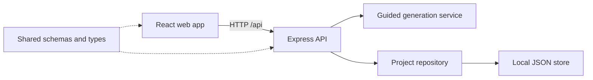

# Architecture

## Boundaries

`apps/web` owns presentation and transient form state. It validates input for fast feedback and validates API responses at the network boundary. Persistent state comes from the API. Export and generation actions report actual server outcomes.

`apps/api` owns authoritative validation, project lifecycle rules, generation, and persistence. The HTTP application is separate from the listening process so integration tests can run on temporary ports with isolated storage.

`packages/contracts` owns the transport vocabulary. Both applications consume it without importing each other's implementation. It exports runtime Zod schemas and TypeScript types; build it before starting either application.

## State and storage

A project stores a creator's brief and an optional generated draft. Drafts include an editable script and timed shots, plus server owned generation metadata. Changing the brief invalidates generated material to avoid presenting an old plan as current. Ready state requires a draft.

The initial storage adapter uses an atomic JSON file and serialized mutations inside one API process. It needs a persistent writable disk. It does not coordinate multiple server replicas. Replace the repository adapter with a transactional database before horizontal scaling or shared user accounts; preserve the HTTP contract when doing so.

## Generation boundary

The included provider is deterministic guided generation. It supplies a useful starter structure that the creator must review and edit. It does not research factual claims or render media. Future model calls belong behind the generation service, with provider secrets only on the backend. Long running media jobs should have their own status and failure model rather than holding an HTTP generation request open.

## Deployment

Build from the root so the shared runtime package is emitted before consumers. The web build is static. The API is a separate Node process and must retain its shared package runtime dependency. Set a frontend API base URL and backend allowed origin for separate origins, or configure an external reverse proxy to route `/api` to the API.

Loopback binding and no authentication are deliberate local development defaults. This first slice does not implement user identity or tenant isolation. Do not treat changing CORS as adding access control.
