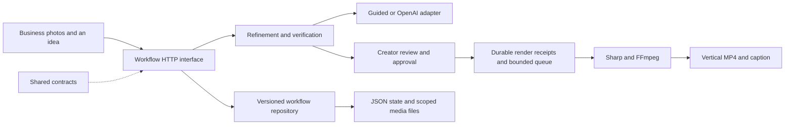

# Architecture

## Boundaries

`apps/web` owns presentation and transient form state. It validates input for fast feedback and validates API responses at the network boundary. Persistent state comes from the API. Export and generation actions report actual server outcomes.

`apps/api` owns authoritative validation, project lifecycle rules, generation, and persistence. The HTTP application is separate from the listening process so integration tests can run on temporary ports with isolated storage.

`packages/contracts` owns the transport vocabulary. Both applications consume it without importing each other's implementation. It exports runtime Zod schemas and TypeScript types; build it before starting either application.

The additive `@yap/contracts/workflow` and `@yap/contracts/render` exports keep the new promo flow separate from the original project schemas. `/api/projects` remains compatible. The frontend session can integrate the new interface without importing backend source; [the integration guide](promo-backend.md) contains the exact flow and fetch examples.

## State and storage

A project stores a creator's brief and an optional generated draft. Drafts include an editable script and timed shots, plus server owned generation metadata. Changing the brief invalidates generated material to avoid presenting an old plan as current. Ready state requires a draft.

A promo workflow adds a conversation, incomplete brief, uploaded photos, questions, script segments, scenes, and approvals. Every mutation carries `expectedVersion`. Slow model calls happen outside the write queue, followed by an atomic version comparison; a concurrent edit wins rather than being overwritten by an older model response. The latest 50 full workflow snapshots are retained for inspection.

Content changes advance `contentRevision` and clear downstream material and approvals. A script points to its source content revision; scenes point to an immutable script ID. Editing either creates a new artifact ID. An approval refers to the exact content revision or artifact ID, so an older approval cannot authorize changed material.

The initial storage adapter uses an atomic JSON file and serialized mutations inside one API process. It needs a persistent writable disk. It does not coordinate multiple server replicas. Replace the repository adapter with a transactional database before horizontal scaling or shared user accounts; preserve the HTTP contract when doing so.

## Generation boundary

The workflow provider has two adapters: guided templates and OpenAI Responses with strict structured output and supplied image inputs. The adapter proposes content; it cannot approve it. Provider secrets stay on the backend. Requests and responses are bounded, model refusals and timeouts have explicit errors, and disconnected requests cancel provider work. Tests use injected fetch and do not call a live model.

The main product path uses `/prepare` to propose both script and scenes, followed by one explicit `/approve-all`. Detailed stage generation and approval endpoints support closer review. Structural verification checks completeness, duration totals, segment coverage, current source revisions, and valid photo references. Review warnings identify defaults, user supplied claims, and uncertain factual content. Passing structural checks is not factual verification or automatic creator approval.

## Photos and rendering

Photos are uploaded as binary PNG, JPEG, or WebP, decoded and bounded with Sharp, and stored under server-issued workflow and asset IDs. Client filenames never become filesystem paths. Photo bytes and hashes are checked before use; no arbitrary external image URLs are fetched. Model image understanding is only available through the configured OpenAI adapter; guided preparation does not pretend to recognize photo contents.

An approved promo is pinned to a workflow version and scene artifact. A bounded queue runs one FFmpeg job at a time, outside the JSON mutation queue. The renderer composes the actual photos, brand/title text, scene text, and final action into 1080×1920 H264/yuv420p video at 24 fps, with exact scene duration and fast-start metadata. The result is silent; no stock audio, invented footage, voiceover, or social publishing is implied.

Render receipts persist `queued`, `running`, `succeeded`, or `failed` state. The queue checks current approval and source identity before and after rendering. Content changes during a render cause a truthful failure rather than presenting stale material as current. Photo deletion is rejected while a render uses the workflow. Download and publish-kit endpoints verify the completed file's size and SHA256, and video responses support HTTP ranges for preview.

Private intermediate frames live in a verified, job-scoped directory beside the output. Normal completion and cancellation remove it. On restart, interrupted receipts become failed and known intermediate/output paths are cleaned. A crashed job is not silently resumed or reported successful. The publish kit provides a current downloadable MP4 and caption for manual posting.

## Deployment

Build from the root so the shared runtime package is emitted before consumers. The web build is static. The API is a separate Node process and must retain its shared package runtime dependency. Set a frontend API base URL and backend allowed origin for separate origins, or configure an external reverse proxy to route `/api` to the API.

Loopback binding and no authentication are deliberate local development defaults. This first slice does not implement user identity or tenant isolation. Do not treat changing CORS as adding access control.

For hosted business accounts, add identity and tenant checks at the HTTP/repository interface, move metadata to a transactional database, move media to object storage, and run render workers behind a durable distributed queue. The current JSON/one-process adapter deliberately does not claim to provide those deployment capabilities.
