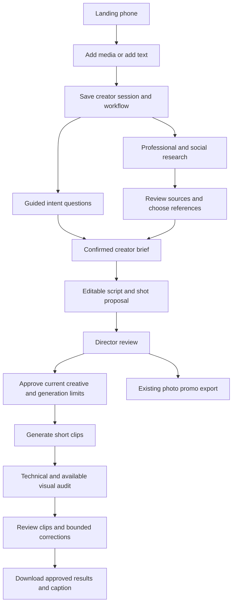

# Creator studio: from an idea to reviewed cinematic clips

## Product direction

The landing page is the entrance to a working creative studio. A person can click the phone, describe something they want to promote, attach their own media, and develop a video without first understanding a production form.

There are two views of the same saved project:

1. **Guided** is an interview with a creative producer. It asks the next useful question, explains what has been understood, and introduces relevant examples as research becomes available.
2. **Director** is the production workspace. It exposes the brief, sources, script, shot choices, generation limits, clips, and audit results together. A creator can change direction without starting another project.

Both views use the same session, workflow, media, selected references, approvals, and generation jobs. They are not separate draft copies. Add media and Add text are entry actions available in both views.

The visual direction continues the existing site: Manrope, graphite, white, silver, large readable copy, actual imagery, and restrained physical motion. Color belongs to the media. The defining interaction is the move from a cinematic phone preview into a usable production desk.

## What already exists

- A landing catalog of 77 distinct licensed examples, including 25 silent MP4s, with deduplication and source hashes. Preserve its capacity limits and selection behavior.
- Versioned business workflows with creator facts, uploaded photographs, editable script and scenes, and explicit approval.
- Guided proposals without model credentials, and an optional text and image model provider.
- Durable photo-based MP4 rendering and downloadable captions. This is a real renderer, but it does not synthesize new video footage.
- Public social research, an optional actual Deep Agents harness, bounded tool activity, inspectable artifacts, and attributed research handoff.
- Dirty navigation protection, conflict handling, input validation, and production packaging checks.

The new studio composes these capabilities and adds a saved creation session, parallel professional and social research, source selection, and bounded generated-clip production. Existing promo and social routes remain usable.

## The complete journey

### 1. Enter through the phone

- The landing phone provides a visible, keyboard accessible creation action.
- Existing preview, playback, still selection, counters, and the no-repeat catalog continue to work.
- The action opens the studio through the existing exact-origin, exact-frame message bridge.
- Direct studio routes work without first visiting the landing page.
- A person can return to the landing page without losing a saved project.

### 2. Start with media or text

The initial composer accepts plain language rather than requiring every field. Useful examples include:

- “Make a launch reel for this handmade lamp.”
- “A quiet, cinematic weekend guide to our cafe in Brooklyn.”
- “Explain this public GitHub project to developers in 15 seconds.”
- “I want this product to feel precise, tactile, and expensive.”

Add media shows actual upload previews, file names, size errors, and saved state. Initially supported uploads are the image formats the existing backend validates: JPEG, PNG, and WebP. Video upload is not implied by a button that only accepts photographs.

Add text accepts a product description, place, goal, natural-language idea, or public GitHub link. A link is not silently treated as permission to execute code or collect private content.

Creator-entered information is kept separate from external observations and creative suggestions. Imported material has a source and a review state.

### 3. Clarify intent progressively

Ask one useful question at a time in Guided view. Director view exposes the same answers as editable fields. Questions should resolve actual missing decisions:

| Decision      | Example question                                    | Production consequence                               |
| ------------- | --------------------------------------------------- | ---------------------------------------------------- |
| Subject       | What are we making people notice?                   | Keeps the visual subject and script consistent.      |
| Audience      | Who should this feel made for?                      | Changes vocabulary, pacing, and example relevance.   |
| Goal          | What should a viewer do afterward?                  | Defines the closing beat and call to action.         |
| Place         | Is there a real location we should show or mention? | Constrains setting without inventing a location.     |
| Product truth | What can we accurately say about it?                | Separates supported claims from aesthetic direction. |
| Style         | Which of these examples feels closest?              | Adds selected presentation context.                  |
| Format        | Where will this play, and for how long?             | Sets aspect ratio, target duration, and shot budget. |
| Constraints   | Anything we must include or avoid?                  | Defines negative prompts and audit checks.           |

Questions depend on the supplied input. A GitHub project needs its actual function and intended developer audience; a location reel needs place and occasion; a product reel needs recognizable features and a commercial goal.

User corrections take precedence over inferred suggestions. A deterministic guided path must describe itself honestly; it must not claim a model understood an image or website when none was called.

Answers save independently from the research request. The person can keep defining intent while research runs.

### 4. Research in parallel

Start research after there is enough of a subject to search usefully. Run distinct bounded tasks:

1. **Professional direction:** find credible material about cinematography, lighting, camera movement, composition, practical product filming, editing, and the relevant subject.
2. **X field research:** discover public examples and source posts relevant to the subject and audience.
3. **TikTok field research:** discover relevant public examples with explicit limits on what indexed results establish.
4. **Instagram field research:** discover public reels, creators, and product examples with the same provenance requirements.
5. **Optional public project context:** read bounded GitHub metadata and README material when the creator supplied a supported public repository URL.

Professional material should prefer original practitioners, production companies, manufacturers, and established cinematography publications. A search snippet is an observation about an indexed source, not proof that the entire film was watched.

An actual Deep Agents run is labeled as such only when the configured harness really executes. Ordinary public search is labeled as public research. No-key operation shows unavailable live providers and can offer clearly labeled existing reference material; it must not manufacture posts, metrics, a live tool feed, or a completion percentage.

Each task reports actual state: queued, running, completed, partial, unavailable, canceled, or failed. Progress reflects work performed. Saved source counts, timestamps, errors, and coverage remain inspectable.

Research takes an input revision snapshot. A result from an older direction cannot overwrite newer answers. A creator can review an older result as historical material or explicitly run research again for the current direction.

### 5. Show examples that help a decision

Examples are presented as a reference board with a source, platform, title, short evidence excerpt, collection time, and any known publication date. Popularity is shown only when the provider observed it. Unknown metrics stay unknown.

The separate verified campaign catalog can supply curated watch references when integrated. Those are reference links, not footage licensed for inclusion in the creator's output. The licensed landing catalog remains its own distinct illustrative collection.

The person chooses what to adopt: a camera move, lighting treatment, pacing, hook, composition, or transition. They can also record what to avoid. A like is an explicit creative selection, not permission to copy a competitor's claims, identity, product appearance, soundtrack, or footage.

Only reviewed selections are passed to proposal generation. Preserve the source URLs and the explanation of how the reference informed the work.

External media should not autoplay unrestricted embeds. Source links and lightweight previews must have honest provenance and appropriate usage rights. Never download campaign footage and represent it as app output.

### 6. Build an editable proposal

The proposal joins the confirmed creator brief with selected creative direction. It produces:

- A concise concept and intended emotional effect.
- A hook, script segments, caption, and call to action.
- A shot list with a clear subject, action, setting, framing, camera movement, lighting, and duration.
- Source-image assignments when photographs are supplied.
- Positive and negative generation instructions.
- The selected model, aspect ratio, clip duration, maximum clips, and maximum attempts.
- A clear distinction between a proposed shot, a still preview, a generated clip, and a completed export.

Director view makes these values inspectable and editable. Changing the creator facts, script, sources, references, or production parameters invalidates the affected approval. Historical clips remain visible with their source revision; they do not become outputs of a new edit.

### 7. Approve the current work and its bounds

Before a paid model request, the person reviews the exact current script, shots, provider, durations, clip count, and attempt limit. Existing workflow approval remains meaningful.

Generation uses a saved plan identity and current workflow version. A second click or retry must not create another charged job for the same accepted request. A stale approval is rejected rather than replayed against changed material.

Display limits the application actually enforces. If a currency estimate is unavailable, say so and show the bounded number of clips and attempts; do not invent a price. A canceled provider request may still be billed by that provider.

The follow-up budget requirement is a **USD 35 total application API budget**, with a durable spend ledger, explicit currency quote approval, and no automatic paid retries. This is an integration gate before live keys are enabled. The current creator checkpoint has durable attempt/seconds limits, not this monetary guard; its bounded automatic correction must be replaced by the coordinated manual retry policy before paid execution. Provider selection must follow verified current API pricing rather than the unverified per-second estimate.

### 8. Generate small clips and audit them

Use a currently supported provider through a server-only adapter. The initial candidate is Runway's active Gen-4.5 REST interface, verified against its official reference. Do not use the retired OpenAI Sora/Videos API or retired Gemini preview model identifiers.

Each shot is a small independently inspectable job. Save request identity, provider task ID, attempt count, source plan, status, and output receipt. Poll at the provider's documented interval. Keep API keys and raw provider failures out of browser state.

Download completed results into bounded local storage, validate content, and retain a content hash. An external download URL alone is not a durable completed output.

Audit categories:

| Audit                          | What can be established                                                                              |
| ------------------------------ | ---------------------------------------------------------------------------------------------------- |
| Transport                      | A completed provider task produced bounded downloadable bytes.                                       |
| Decode                         | The file decodes as video and has usable dimensions and duration.                                    |
| Production match               | Duration, aspect ratio, and expected shot identity match the approved request.                       |
| Visual review, when configured | Sampled frames are reviewed for subject fidelity, framing, unwanted text, and requested constraints. |
| Human review                   | The creator decides whether the result actually represents their product and is suitable to publish. |

A missing visual-audit provider is shown as not run. A model's own opinion is not independent proof of product truth or quality. Technical pass and aesthetic approval are separate states.

Automatic correction is limited by the approved attempt budget. Do not enter an open-ended regenerate loop. A rejected clip exposes the reason and allows a deliberate correction or retry. Cancellation stops local work, attempts provider cancellation, and explains any residual billing uncertainty.

### 9. Review and deliver

Show the actual generated clip next to its shot instructions and audit receipt. Downloads point to stored, validated outputs. The existing photo-based MP4 and caption path remains available for a creator who wants that production method.

No automatic social posting is added. The creator reviews the final media and publishes it themselves.

## Architecture and ownership

| Module                              | Responsibility                                                                                            |
| ----------------------------------- | --------------------------------------------------------------------------------------------------------- |
| `@yap/contracts/creator`            | Validated input, answer, research, session, production-plan, job, and audit contracts.                    |
| Creator repository/router           | Saved session and revision handling, workflow link, async research and production commands.               |
| Creator research module             | Bounded public source discovery and supported public GitHub context, with citations and coverage.         |
| Creator production module           | Provider adapter, attempt limits, durable job receipts, local output storage, and audit.                  |
| Existing workflow repository/assets | One shared instance for creator facts, image validation, editable proposals, and approval.                |
| `apps/web/src/creator/*`            | Guided and Director views over one saved session; actual API state and local drafts.                      |
| App and landing bridge              | Routes, phone entry, navigation protection, and research handoff.                                         |
| Existing social workspace           | Independently owned research UI; preserve `apps/web/src/social/*`.                                        |
| Existing catalogs                   | Preserve 77 distinct landing examples and separately consume reviewed campaign references when available. |

Do not open a second writer on the same workflow JSON file. The creator router shares the workflow repository and asset store already created by the existing workflow router.

## Reliability and security

- All mutations use the relevant current revision and validate through shared contracts.
- Keep creator facts, imported source text, selected creative context, and model suggestions separate.
- Treat README files, web pages, social excerpts, and model outputs as untrusted content, never as server instructions.
- Do not clone or execute a supplied repository. Read supported public metadata through fixed provider hosts.
- Bound URLs, redirects, response sizes, timeouts, retained records, and total external requests. Reject local/private network targets if arbitrary fetch is introduced.
- Keep provider credentials server-only. Cap concurrent research and generation work and sanitize errors.
- Cancel owned work on shutdown. Recover unfinished durable jobs truthfully after restart.
- Preserve local edits on conflicts and failed saves. Do not silently overwrite them with polling results.
- Missing provider configuration is a useful explicit state, not a reason to substitute invented live research or generated footage.

## Interface quality

- Guided view prioritizes one question and one next action; detailed controls remain available in Director view.
- Use a consistent project title, stage indicator, source count, and saved-state feedback in both views.
- A reference board, shot strip, and clip audit correspond to actual data. Avoid decorative dashboards and arbitrary agent activity.
- On small screens, use a single reading order and accessible panels instead of shrinking a three-column editor.
- All inputs have visible labels; actions have focus treatment and loading, disabled, error, and empty states.
- Respect reduced motion, preserve focus through view changes, and announce meaningful asynchronous completion without flooding assistive technology.
- Media color may vary; the interface palette remains neutral.

## Implementation work packages

1. Sync reviewed main and preserve the unique catalog before changing the studio.
2. Define the additive creator contract and share the workflow repository/asset store.
3. Implement durable sessions, supported intake, adaptive questions, and versioned answers.
4. Implement concurrent professional/social research with real coverage and attributed results.
5. Implement Guided and Director over the same session, including source selection and proposal review.
6. Connect the landing phone and existing social handoff to the studio.
7. Implement a supported video provider, explicit production approval, bounded attempts, stored outputs, and audit receipts.
8. Independently audit frontend behavior and backend invariants; fix concrete findings.
9. Run contracts/API/frontend/showcase tests, type checking, formatting, builds, and browserless HTTP packaging checks.
10. Start a local preview for the user, report the URL and tested commit, and preserve feature history with regular merges.

## Acceptance scenarios

- Text-first, image-first, place, product, and supported public GitHub inputs create recoverable saved work.
- Switching Guided/Director preserves the same identity, answers, uploads, selected references, and pending changes.
- An interview remains usable while source research runs.
- Relevant questions change with the input; explicit answers override inferred suggestions.
- Professional, X, TikTok, and Instagram coverage is visible, including missing access and partial failure.
- Selecting an example changes creative context while preserving creator-owned facts and attribution.
- A changed direction cannot receive an old research result as current context.
- Script and shot edits invalidate affected approval; a stale version is rejected.
- Missing model credentials never produce a claimed generated clip.
- Repeated generation clicks cannot duplicate a charged job; attempts remain bounded through retry and restart.
- Completed clips have real bytes, decode successfully, and expose truthful audit scope.
- Cancellation, provider failure, timeout, stale state, and output-integrity failures have recoverable honest UI states.
- The existing 77-example catalog remains unique, and existing photo promo/social flows continue to pass.
- Packaged media URLs, source credits, iframe entry, and API routes work from a local production preview without computer use.

## Current official implementation references

- [Runway API reference](https://docs.dev.runwayml.com/api/) for current text/image-to-video requests, task polling, and cancellation.
- [OpenAI video generation documentation](https://developers.openai.com/api/docs/guides/video-generation) records the September 2026 retirement of Sora and the Videos API; it is not a supported integration target.
- Existing repository guides: [promo backend](promo-backend.md), [research harness](deepagents-demo.md), and [social research](social-analysis.md).

Live model and external-platform execution require the corresponding server credentials and account access. Mocked provider tests establish application behavior, not that a paid model or platform was contacted. Record the actual validation performed in the implementation handoff.
