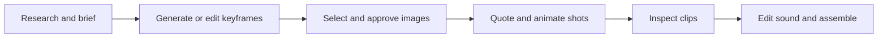

# Gorm Studio comparison and Yap adoption plan

Researched November 14, 2026. Yap baseline: main `f866837`, pulled before publication; core production source remains unchanged from audited `b52f273`. This is an implementation plan, not a new provider integration or a paid output benchmark.

## Recommendation

Add a **generate/edit still -> choose a version -> animate -> review -> assemble with sound** workflow to Yap. Start with the OpenAI image API and the existing fal video adapter. Keep Yap's research handoff, versioned approvals, exact quotes, durable spend reservations and manual retry limits. Evaluate a different video model only after the image workflow is useful.

The visible advantage in Gorm is the creator's ability to iterate on an actual visual before buying motion. Reproducing that interaction is a more targeted first improvement than replacing Yap's video provider or adding an open-ended production agent. This is an architectural recommendation based on inspected interfaces, not a measured image/video quality ranking.

## What Gorm actually exposes

The public [studio](https://studio.gormtheold.net/toolbox/gorm-studio) presents GPT Image 2.6 Flare image creation/editing, reference images, a saved image/video library, and animation of a selected image. Its delivered client labels animation MiniMax H3 Max, 768p, with audio. Character replacement is a separate [tool](https://studio.gormtheold.net/toolbox/character-swap).

Its [privacy policy](https://studio.gormtheold.net/privacy) discloses Supabase, Stripe, Cloudflare/R2, OpenAI, AtlasCloud and fal.ai/model providers including MiniMax. This is operator disclosure, not a trace proving which upstream endpoint served a particular job. No inspected evidence establishes Higgsfield use.

The delivered public client is written to call ordinary application API routes for generation, animation, saved media and credits; no paid generation request was submitted during inspection. The client preserves a request identity before submission, polls existing jobs and separates completed generation from library-storage recovery. It does not expose a general model-selected tool registry. A private backend could have additional orchestration; the Advanced route requires login. See the [site evidence](gorm-studio-site-evidence.md) for exact contracts, source assets and limits.

The current landing embed is Vimeo **1246379440, Gorm Studio 2**. A different video ID in the landing component is an unused default; the homepage supplies the actual ID. The retrieved English auto-generated transcript describes per-event context and stored visuals before animation (03:05-03:16). This supports per-scene context/lineage, not a conclusion about an unrestricted agent tool loop. Timestamped paraphrases are in [video notes](gorm-studio-video-notes.md).

## Proposed production flow

## Comparison with current Yap

| Capability                           | Gorm public evidence                                                                   | Yap main implementation                                                            | Decision                                                                |
| ------------------------------------ | -------------------------------------------------------------------------------------- | ---------------------------------------------------------------------------------- | ----------------------------------------------------------------------- |
| Generate/edit a visual before motion | Generated stills, references, prompt/quality/size controls                             | Photos and text clip plans, but no still-image generator                           | Highest-value addition                                                  |
| Reuse visual decisions               | Saved image/video library and reuse as references                                      | Stored own photos and produced clips; no generated-image variant lineage           | Add a creator asset library with versions and provenance                |
| Animate a chosen still               | Visible image-to-video action, with audio                                              | Existing fal Seedance 1.5 Pro or explicit Runway Gen-4.5                           | Reuse the adapter initially; benchmark alternatives later               |
| Character replacement                | Separate video-plus-reference-photo tool                                               | Not implemented                                                                    | Separate later feature, only if users need it                           |
| Sound                                | Animation UI advertises included audio                                                 | Providers/plan request silence; assembly strips audio                              | Add explicit sound settings and change validation deliberately          |
| Research-to-script                   | Not established by inspected public routes                                             | Firecrawl and optional real Deep Agents research with attributed handoff           | Retain Yap's implemented path                                           |
| Tool orchestration                   | Browser-to-own-API operations are observable; server internals unknown                 | Deep Agents tools serve research; production is application controlled             | Add typed production operations before considering an agent loop        |
| Cost/recovery                        | Credit-state UI, UUID recovery and storage retry; backend ledger guarantees unverified | Source-audited quotes, shared ledger, idempotency, manual retry limits, clip audit | Preserve existing guarantees; learn from the asset-saving recovery UX   |
| Timeline/editor                      | Demo describes event sequences; gated Advanced implementation not inspected            | Ordered editable clip plans and deterministic assembly, not multitrack editing     | Scope a small edit-decision model separately                            |
| Hosted service                       | Declared auth, database, billing and object storage                                    | Single-process JSON/files; S3 is currently manual export                           | Hosting is a later deployment project, not required to add still images |

Yap details and pinned source references are in the [production stack audit](yap-production-stack-audit.md). The latest poster workspace saves prepared directions but explicitly does not generate poster images, so it does not close the still-image generation gap. [Current poster guide](https://github.com/Emmit3/yap./blob/f866837/docs/poster-references.md). The comparison does not establish that either provider produces better finished footage: neither was tested on an identical funded brief during this research. Upscaling Yap's native 720p clips into a 1080x1920 container does not add native image detail.

## Provider choice

**First: direct OpenAI images.** Use separate generation and edit jobs with a documented model such as `gpt-image-2.6-flare`. It is a real provider model matching Gorm's displayed family, although that alone does not verify Gorm's server mapping. The [model page](https://developers.openai.com/api/docs/models/gpt-image-2.6-flare) and [edit API](https://developers.openai.com/api/reference/resources/images/methods/edit/) document the capabilities. These are calls from Yap's backend to the developer API, not browser automation of ChatGPT or use of a consumer subscription.

**Alternative: image editing through fal.** `google/nano-banana-2.1/edit` can use the existing FAL_KEY and familiar queue lifecycle, with model-specific inputs, output validation and pricing. This reduces new authentication/lifecycle work, but still requires a real image adapter. [Official schema](https://fal.ai/models/google/nano-banana-2.1/edit/api).

**Higgsfield: optional later provider.** Higgsfield has a genuine async API, model catalog, cost estimates, request IDs and polling/webhooks. It would require its own adapter and cancellation/retention rules. Choose it for a specific capability that wins a comparison, rather than assuming Gorm uses it or treating its consumer UI as an API contract. [API overview](https://docs.higgsfield.ai/docs), [request lifecycle](https://docs.higgsfield.ai/docs/concepts/requests).

**Comparable video without new infrastructure:** fal documents `minimax/h3-max/image-to-video`, so Yap can evaluate the same named model family using FAL_KEY. This still needs a model-specific adapter/schema, quote rules and audio-aware review. fal describes its offering as a post-trained variant; it is not proof of identical output to AtlasCloud or Gorm. [fal API](https://fal.ai/models/minimax/h3-max/image-to-video/api), [model description](https://fal.ai/minimax-h3-max).

Details and limitations: [provider options](image-generation-provider-options.md).

## Proposed creator journey

1. Research and save a brief using the current connected creation session.
2. Draft shot cards with a subject, action, reference assets and intended motion.
3. Generate a bounded number of portrait keyframe variants, or upload a creator-owned frame.
4. Edit the chosen frame using explicit references; preserve previous variants and input identity.
5. Approve the selected frame and the exact animation quote.
6. Generate that shot through the selected video adapter, then run existing technical/visual checks.
7. Reuse passed shots; revise only the shot needing work with a new explicit quote.
8. Assemble approved shots, optional sound and timed captions; review and download.

Generated assets must be labeled as generated, separate from creator-owned photos and attributed third-party references. An external reference can inform technique; it must not silently become a production asset or a verified product fact.

## Implementation sequence

### 1. Image jobs and asset library

- Add an image-provider interface and bounded create/edit requests. Start with one configured model rather than a large model picker.
- Store image variants with asset ID, parent version, prompt, provider/model, request ID, input hashes, dimensions, file type and output hash.
- Give each shot a compact versioned context record: approved intent, creator facts, selected reference evidence, prompt history and selected visual. A per-scene context does not require a new unrestricted agent or an unbounded set of independent paid conversations.
- Extend the current paid-request gate and pricebook deliberately: it currently permits a bounded text/vision model and rejects image endpoints/built-in paid tools. Adding OPENAI_API_KEY alone is insufficient.
- Reserve the approved image cost before dispatch; retain uncertain outcomes and their original request identity. Retry saving a completed result without ordering another generation.
- Add a visual selection/edit step to Guided and Director, backed by the same session and generated-asset repository.

Acceptance: one brief can produce a keyframe, revise it using an approved reference, select the exact variant, reload without losing lineage, and animate it without bypassing quotes or repeating a paid image request.

Likely seams: `packages/contracts/src/creator.ts`, a new image-provider module, `creator-paid-requests.ts`, `creator-budget.ts`, `creator-repository.ts`, `creator-router.ts`, and the existing creator workspace.

### 2. Connect approved stills to existing video

- Extend the clip asset contract and resolver to accept an owned generated-image version as well as an own-photo asset. Current clip validation and jobs resolve only workflow.assets through WorkflowAssetStore; a separate image repository will not connect automatically. Preserve an explicit generated kind/provenance instead of pretending generated files were uploaded photographs.
- Include that image's identity/hash and intended provider/model in the quote fingerprint. Editing the frame invalidates dependent animation approval.
- Reuse the current fal image-to-video path, task persistence, clip inspection and manual retry behavior.
- Add immutable per-shot fingerprints and an explicit cross-plan reuse policy. Current reuse searches the same planId, while a plan edit creates a new planId; preserving other passed shots therefore requires a deliberate extension. Reuse only when provider/model, prompts, timing, input hashes and passed audit receipts match the new approved plan. A saving/download failure must be distinguishable from generation failure.

Acceptance: editing shot two leaves passed shots one and three available; reload reconnects to accepted work without a duplicate provider submission.

### 3. Audio and a small editing model

- Model native generated audio, narration and music as explicit optional assets/settings with their own provenance and costs.
- Update the current no-speech/music generation prompt, provider payloads, hasAudio contracts, quote profile/fingerprint, assembly flags and final validation together. Merely choosing a model with audio will not work while the request asks for silence and FFmpeg removes it.
- Introduce a versioned edit-decision list: ordered asset IDs, trim in/out, duration, basic transitions, audio levels and timed captions. Build deterministic preview/assembly before a full timeline UI.
- Keep the social-post caption distinct from actual timed subtitles.

Acceptance: exported media has the approved duration and intended audio tracks; subtitle timing matches the edit; an edit-only change does not buy new footage.

### 4. Evaluate model alternatives and optional production tools

- Compare current Seedance/Runway with the documented fal MiniMax H3 Max adapter using the existing FAL_KEY; evaluate Higgsfield only for an identified useful model or motion operation. Validate supported duration/resolution/audio against the selected provider schema rather than copying Gorm UI limits.
- Use the same approved stills, motion requests, aspect ratio and approximate duration. Record every attempt, total actual cost when available, latency and failures.
- Score reference/subject consistency, motion, temporal artifacts, prompt adherence, usable-shot rate and audio suitability with human review. The current three-frame check is useful screening, not a sufficient perceptual-quality benchmark.
- Only change a default when its useful-shot rate, cost and latency justify it. A successful HTTP response, resolution label or attractive demo is insufficient.
- If conversational production is useful later, expose narrow typed operations over the proven services: prepare/edit keyframe, request approved animation, inspect result and assemble approved assets. A tool call must not grant its own cost or content approval.

Acceptance: a documented provider comparison supports the choice, and every paid production operation retains version, quote, budget and request-identity checks.

## What to implement first

Build phase 1 and its connection to the existing image-to-video path. This closes the clearest workflow gap while reusing the working production engine. Audio/editing follows; character swap, a broader provider catalog and hosted billing/identity remain separate decisions. No new provider, purchase or paid generation was performed as part of this research.
